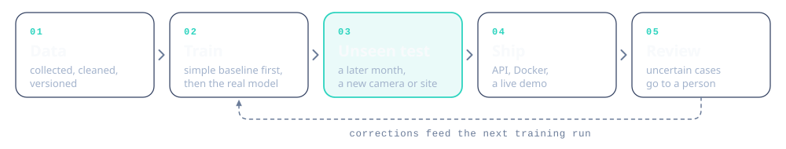

<picture>
  <source media="(prefers-color-scheme: dark)" srcset="assets/banner-dark.svg">
  <source media="(prefers-color-scheme: light)" srcset="assets/banner-light.svg">
  
</picture>

I build machine learning systems from data pipeline to deployed API, then test them on data they have never seen. When a model misses its target, the README says so.

B.E. Software Engineering, Nepal College of Information Technology, 2026 &nbsp;·&nbsp; Kathmandu, Nepal

**Open to Machine Learning Engineer and Applied ML Engineer roles, remote or on-site.**

<!--
  Add your contact links, then delete the comment markers around this block.

  
  

-->

## Featured work

<table>
<tr>
<td width="50%" valign="top">
<a href="https://github.com/professor3333/ProtocolLedger"><picture>
  <source media="(prefers-color-scheme: dark)" srcset="assets/card-protocolledger-dark.svg">
  <source media="(prefers-color-scheme: light)" srcset="assets/card-protocolledger-light.svg">
  
</picture></a>
<b><a href="https://github.com/professor3333/ProtocolLedger">ProtocolLedger</a></b> &nbsp;·&nbsp; <a href="https://44.222.11.189.sslip.io">Live demo</a> 
Turns free-text lab protocols into an editable prep sheet, with every value linked to its source text.
</td>
<td width="50%" valign="top">
<a href="https://github.com/professor3333/fraud-risk-scoring"><picture>
  <source media="(prefers-color-scheme: dark)" srcset="assets/card-fraud-risk-scoring-dark.svg">
  <source media="(prefers-color-scheme: light)" srcset="assets/card-fraud-risk-scoring-light.svg">
  
</picture></a>
<b><a href="https://github.com/professor3333/fraud-risk-scoring">Fraud Risk Scoring</a></b> &nbsp;·&nbsp; <a href="https://fraud-risk-scoring-m1fp.onrender.com">Live dashboard</a> 
Calibrated fraud scores that approve, review or block within an analyst team's daily budget.
</td>
</tr>
</table>

<table>
<tr>
<td width="50%" valign="top">
<a href="https://github.com/professor3333/wildinbox"><picture>
  <source media="(prefers-color-scheme: dark)" srcset="assets/card-wildinbox-dark.svg">
  <source media="(prefers-color-scheme: light)" srcset="assets/card-wildinbox-light.svg">
  
</picture></a>
<b><a href="https://github.com/professor3333/wildinbox">WildInbox</a></b> 
A review inbox for trail-camera photos: groups shots into capture events and suggests a species for each.
</td>
<td width="50%" valign="top">
<a href="https://github.com/professor3333/passagewatch"><picture>
  <source media="(prefers-color-scheme: dark)" srcset="assets/card-passagewatch-dark.svg">
  <source media="(prefers-color-scheme: light)" srcset="assets/card-passagewatch-light.svg">
  
</picture></a>
<b><a href="https://github.com/professor3333/passagewatch">PassageWatch</a></b> 
Counts fish moving upstream and downstream in sonar video, keeping the evidence behind every count.
</td>
</tr>
</table>

<table>
<tr>
<td width="50%" valign="top">
<a href="https://github.com/professor3333/shelf-life"><picture>
  <source media="(prefers-color-scheme: dark)" srcset="assets/card-shelf-life-dark.svg">
  <source media="(prefers-color-scheme: light)" srcset="assets/card-shelf-life-light.svg">
  
</picture></a>
<b><a href="https://github.com/professor3333/shelf-life">Shelf Life</a></b> &nbsp;·&nbsp; <a href="https://shelf-life-2l8tanmdatboms9mhxh3rj.streamlit.app/">Live app</a> 
Predicts which job postings come down within seven days, trained on a panel I scraped from seven job boards.
</td>
<td width="50%" valign="top">
<a href="https://github.com/professor3333/beltwatch"><picture>
  <source media="(prefers-color-scheme: dark)" srcset="assets/card-beltwatch-dark.svg">
  <source media="(prefers-color-scheme: light)" srcset="assets/card-beltwatch-light.svg">
  
</picture></a>
<b><a href="https://github.com/professor3333/beltwatch">BeltWatch</a></b> 
Segments cardboard, plastic and metal contamination on paper-recycling conveyors and queues uncertain images for review.
</td>
</tr>
</table>

## How I work

<picture>
  <source media="(prefers-color-scheme: dark)" srcset="assets/workflow-dark.svg">
  <source media="(prefers-color-scheme: light)" srcset="assets/workflow-light.svg">
  
</picture>

## Toolbox

  
  
  
  
  
  
  
  
  
  
  
  
  
  
  
  

