<picture>
  <source media="(prefers-color-scheme: dark)" srcset="assets/banner-dark.svg">
  <source media="(prefers-color-scheme: light)" srcset="assets/banner-light.svg">
  
</picture>

Software engineering graduate (B.E., Nepal College of Information Technology, 2026) based in Kathmandu, Nepal. I build machine learning systems end to end, from data pipeline to deployed API, and test them on data they have never seen: a later month, a new camera, a different site. When a model misses its target, the README says so.

**Open to Machine Learning Engineer and Applied ML Engineer roles, remote or on-site.**

<!--
  Add your contact links, then delete the comment markers around this block.

  
  

-->

## Featured work

### [ProtocolLedger](https://github.com/professor3333/ProtocolLedger)
NLP &nbsp;·&nbsp; information extraction &nbsp;·&nbsp; <a href="https://44.222.11.189.sslip.io"><b>Live demo</b></a>

Turns free-text lab protocols into an editable preparation sheet, with every extracted value linked back to its source text. A SciBERT span-and-relation model reaches **0.766 entity F1** and **0.580 end-to-end relation F1** on WNUT-2020, ahead of a CRF baseline at 0.504.

<code>PyTorch</code> <code>Transformers</code> <code>ONNX Runtime</code> <code>FastAPI</code> <code>Docker</code>

### [Fraud Risk Scoring](https://github.com/professor3333/fraud-risk-scoring)
Tabular ML &nbsp;·&nbsp; calibration &nbsp;·&nbsp; <a href="https://fraud-risk-scoring-m1fp.onrender.com"><b>Live dashboard</b></a>

Scores card-not-present transactions with a calibrated fraud probability and picks approve, review or block within an analyst team's daily review budget. It reaches **0.907 ROC-AUC** on a held-out later month, at **43% lower cost** than approving everything.

<code>XGBoost</code> <code>scikit-learn</code> <code>SHAP</code> <code>FastAPI</code> <code>MLflow</code>

### [WildInbox](https://github.com/professor3333/wildinbox)
Computer vision &nbsp;·&nbsp; image classification &nbsp;·&nbsp; human-in-the-loop

A review inbox for trail-camera photos that groups shots into capture events and suggests a species for each. Grouping alone cuts the review queue by **61.4%**, and a fine-tuned EfficientNet-B0 scores **0.447 macro-F1 on nine unseen cameras**, against 0.285 for the frozen baseline.

<code>PyTorch</code> <code>FastAPI</code> <code>Streamlit</code> <code>PostgreSQL</code> <code>Redis</code> <code>AWS</code>

### [PassageWatch](https://github.com/professor3333/passagewatch)
Computer vision &nbsp;·&nbsp; detection and tracking &nbsp;·&nbsp; sonar video

Counts fish moving upstream and downstream in sonar video and keeps the evidence so a technician can check every count. It reaches **0.213 count error (nMAE)** across four unseen locations, against 0.388 for a tuned classical baseline.

<code>PyTorch</code> <code>YOLOX</code> <code>OpenCV</code> <code>ONNX Runtime</code> <code>FastAPI</code>

### [Shelf Life](https://github.com/professor3333/shelf-life)
Tabular ML &nbsp;·&nbsp; self-collected data &nbsp;·&nbsp; <a href="https://shelf-life-2l8tanmdatboms9mhxh3rj.streamlit.app/"><b>Live app</b></a>

Predicts which job postings will be taken down within seven days, trained on a panel I scraped from seven job boards. On held-out days, **75% of its daily shortlist were real removals**, 6.8 times the hit rate of reading the board unaided.

<code>scikit-learn</code> <code>XGBoost</code> <code>FastAPI</code> <code>Streamlit</code> <code>MLflow</code>

### [BeltWatch](https://github.com/professor3333/beltwatch)
Computer vision &nbsp;·&nbsp; semantic segmentation &nbsp;·&nbsp; in development

Segments cardboard, plastic and metal contamination on paper-recycling conveyor lines and queues uncertain images for review. SegFormer-B0 reaches **0.336 foreground macro IoU**, against 0.152 for a tuned random forest.

<code>PyTorch</code> <code>SegFormer</code> <code>DVC</code> <code>MLflow</code> <code>FastAPI</code>

## Toolbox

  
  
  
  
  
  
  
  
  
  
  
  
  
  
  
  

